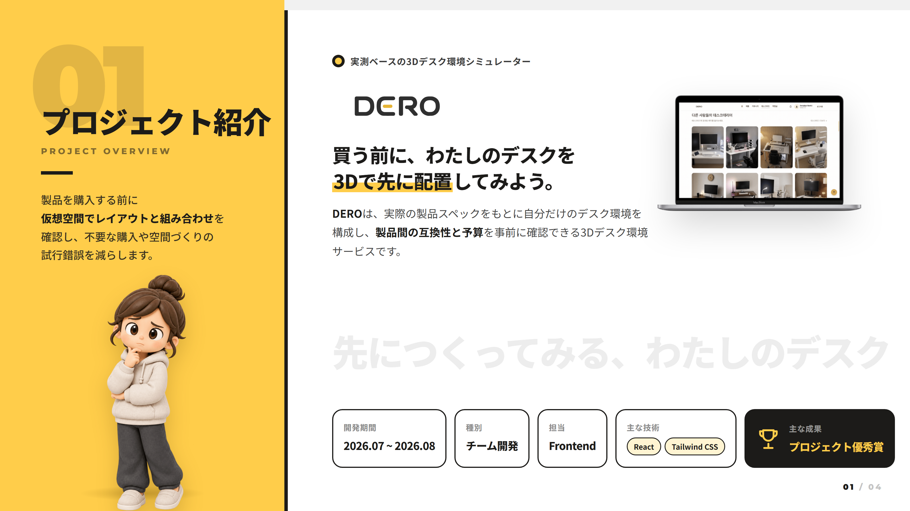
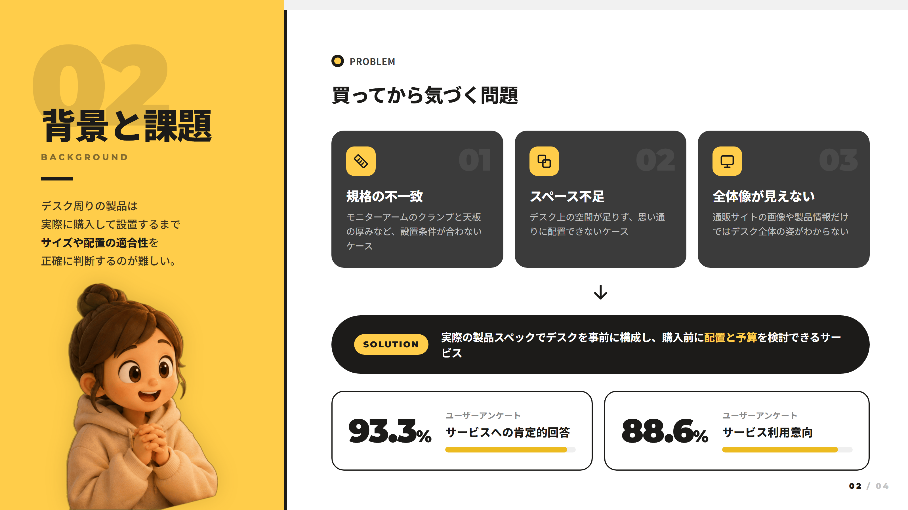
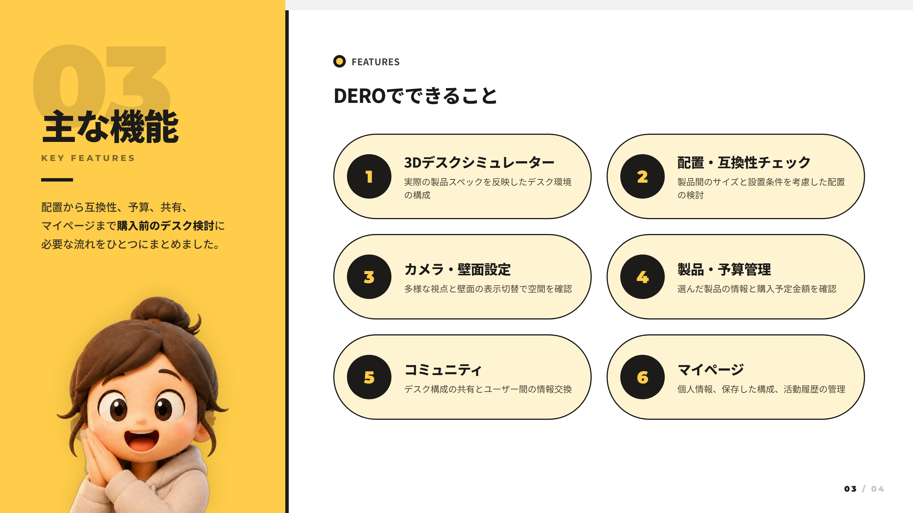
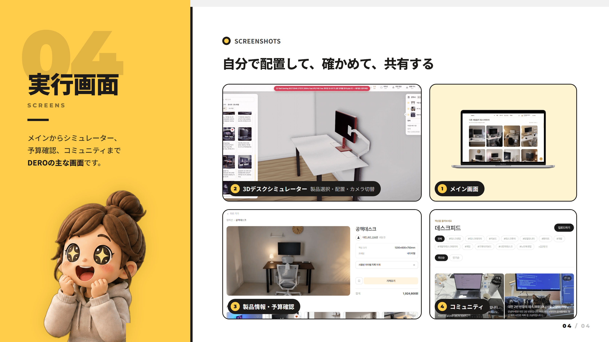

# 🖥️ DERO — 実測ベースの3Dデスク環境シミュレーター

  
  
  
  

## 05. 担当業務

### Frontend（2026.07 ~ 08）

- Reactベースのフロントエンド開発および画面構成
- フロントエンド開発環境をReactベースへ移行する作業に参加
- Tailwind CSSの導入とUI開発環境の構築
- マイページ5画面の構造およびUI設計
- ページごとのUI要素とユーザー導線を考慮した画面構成
- フロントエンド開発中に発生した問題の分析と改善方針の検討

## 06. 技術スタックと選定理由

| 技術 | 選定理由 |
|---|---|
| React | コンポーネントベースの構造による画面開発とUIの再利用 |
| JavaScript | ユーザーイベントの処理と動的な画面構成 |
| Tailwind CSS | ユーティリティクラスによる素早いスタイル適用と一貫したUI管理 |
| HTML / CSS | Webページの構造とレイアウトの構成 |

## 07. 技術実装

### 1) Reactベースのフロントエンド構造

Reactを活用し、サービスの画面をコンポーネント単位で構成する開発環境を構築しました。

ページごとの機能とUI要素を分けて開発し、共通で使えるレイアウトや構成要素を考慮しました。

**主な作業**

- Reactベースのプロジェクト環境構築
- ページおよびUIコンポーネント構造の検討
- 画面ごとのユーザーインターフェース構成
- コンポーネントの再利用を考慮した画面設計

### 2) Tailwind CSSによるUI構成

Tailwind CSSを導入し、スタイルを効率的に適用できるフロントエンド開発環境を構築しました。

画面ごとのレイアウトや余白、UI要素の表現を一貫して管理することに重点を置きました。

**主な作業**

- Tailwind CSSのインストールと設定
- UI要素ごとのスタイル適用構造の検討
- 画面間のレイアウトとデザインの一貫性の考慮

### 3) マイページのUI設計

マイページを構成する5つの画面の構造を設計し、ユーザー情報や活動データを効率よく確認できるUIを検討しました。

- 画面ごとの主要な情報と機能の分類
- メニューとコンテンツ領域の構成
- ページ間の遷移フローの検討
- ユーザー視点での情報配置と操作のしやすさの考慮

### 4) 3Dサービスのユーザーインターフェース

DEROはユーザーが3D空間で製品を選び配置するサービスのため、一般的な情報閲覧ページとは異なり、多様な操作機能を提供します。

製品選択、カメラ切替、壁面表示などの機能を、ユーザーが簡単に理解して使えるインターフェースが重要でした。

これを通じて、3D機能そのものだけでなく、ユーザーが機能を快適に使えるよう画面を構成するフロントエンド設計の重要性を理解しました。

## 08. トラブルシューティングと技術的課題

### 1) フロントエンド開発環境の移行

**課題**

開発の途中でフロントエンド環境をReactベースに変更することになり、既存の画面構成方法とプロジェクト構造を見直す必要がありました。

**対応**

Reactのコンポーネントベースの開発手法に合わせて画面構造とUI構成方法を検討し、開発環境の設定と実行手順を確認しました。

**学び**

フレームワークが変わる場合、単なる文法の変更だけでなく、コンポーネント構造や画面構成の方法もあわせて考える必要があることを学びました。

### 2) UIスタイル管理と一貫性の確保

**課題**

複数の画面を開発する過程ではページごとにスタイルがばらつきやすく、一貫したUI構成の方法が必要でした。

**対応**

Tailwind CSSを適用できる開発環境を構築し、共通スタイルとレイアウト基準を活用する方法を検討しました。

**学び**

個々の画面のスタイル実装だけでなく、サービス全体で一貫したユーザー体験を提供できるようUI構造を管理することが重要だと学びました。

### 3) マイページの画面と情報構成

**課題**

マイページには多様なユーザー情報や活動履歴が含まれるため、機能ごとに画面を分け、直感的な遷移フローを設計する必要がありました。

**対応**

マイページを5つの画面に分け、各画面の情報と機能を整理し、メニュー構造と画面遷移フローを検討しました。

**学び**

フロントエンド開発では、機能の実装だけでなく、ユーザーが求める情報に簡単にたどり着けるよう画面構造を設計する過程も重要だと学びました。

## 09. 学んだことと振り返り

### 学んだこと

- Reactベースのコンポーネント開発と画面構成
- フロントエンドプロジェクトの環境設定と構造の理解
- Tailwind CSSを活用したUIスタイル管理
- マイページなど複数画面の構造とユーザー導線の設計
- 3Dシミュレーターを含むWebサービスのユーザーインターフェース構成

### 振り返り

今回のプロジェクトでは、Reactベースのフロントエンド開発に参加し、コンポーネント構造とUI設計への理解を深めることができました。

特に既存の開発環境を変更し、Tailwind CSSを導入する過程を通じて、プロジェクト設定と画面開発構造の重要性を学びました。

また、マイページの複数の画面を設計しながら、**機能を実装するだけでなく、ユーザーが情報を簡単に確認し、サービスを直感的に利用できるよう構成する過程**が重要だと感じました。

今後は、コンポーネントの再利用性とコードの保守性を高め、さまざまな画面サイズでも一貫したユーザー体験を提供できるフロントエンド開発力を強化していきたいと考えています。

## 10. 出典とライセンス

### 参考資料と外部リソース

- [React](https://react.dev/) — フロントエンド開発
- [Tailwind CSS](https://tailwindcss.com/) — UIスタイリング
- 3D製品モデルおよびテクスチャ — 実際に使用したアセットの制作者とライセンスを表記
- 製品画像および規格情報 — 実際に活用したデータの提供元を表記

### ライセンス

本プロジェクトは教育およびポートフォリオ目的で制作されました。

ソースコードの公開およびオープンソースライセンスの適用可否は、チームの公開方針に従います。
